# Kontor

**One agentic AI platform, many domains.** Kontor is a multi-tenant platform where a fixed, tested **core** (agent loop, model gateway, knowledge layer, approvals, tracing, evals) serves any number of **plugins**. Each plugin turns the core into a domain product (a hospital service desk, an RFQ analyst, a robot-data curation assistant, a sensor-analytics tool) without touching core code.

> **Status (November 2026):** Milestones 2 and 3 are done. The Next.js portals (`web/`) are fed by the FastAPI core (`api/`) with Postgres: tenant isolation, metrics, validation, triage and ids live in the core, the TypeScript types are generated from the API, and CI runs on every push. **Sign-in uses OpenID Connect** (Authorization Code + PKCE) with **Keycloak** as identity provider: the Next.js server is a backend-for-frontend holding tokens in encrypted HttpOnly cookies, the API verifies JWT access tokens via JWKS, customers and platform staff sign in through separate realms (platform staff with mandatory MFA), and roles are enforced by the API. Section 8 tracks what's left, section 9 the plan.

---

## Contents

1. [Why this exists: the problem](#1-why-this-exists-the-problem)
2. [The solution: core + plugins](#2-the-solution-core--plugins)
3. [The three layers](#3-the-three-layers)
    - [Ports and adapters: every core component is swappable](#ports-and-adapters-every-core-component-is-swappable)
    - [What we build: the runtime core](#what-we-build-the-runtime-core)
    - [What we build: the knowledge pipeline](#what-we-build-the-knowledge-pipeline)
4. [The plugin contract](#4-the-plugin-contract)
5. [One request, end to end](#5-one-request-end-to-end)
6. [Four domains, one platform](#6-four-domains-one-platform)
7. [Core capabilities the plugins require](#7-core-capabilities-the-plugins-require)
8. [Current repo: where the frontend is doing the core's job](#8-current-repo-where-the-frontend-is-doing-the-cores-job)
9. [Migration: from today's repo to the target](#9-migration-from-todays-repo-to-the-target)
10. [Rules for contributors and AI coding assistants](#10-rules-for-contributors-and-ai-coding-assistants)
11. [Delivery and operations: containers, CI/CD, cloud, scaling](#11-delivery-and-operations-containers-cicd-cloud-scaling)

---

## 1. Why this exists: the problem

Building an AI product for a new domain usually goes like this:

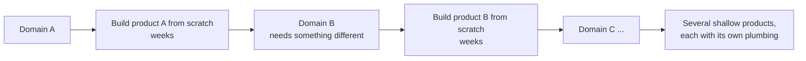

Every new domain resets the work to zero. Most of each product is the same plumbing (auth, multi-tenancy, model calls, retrieval, UI, logging), rebuilt every time and never polished. The domain-specific part, the part users actually care about, gets the least time.

**Generic products** don't fit any domain well. **Custom products** take weeks each. Both lose.

## 2. The solution: core + plugins

Build the plumbing **once**, to production quality. Make the domain part a **plugin**: a folder with a fixed shape that the core discovers and loads.

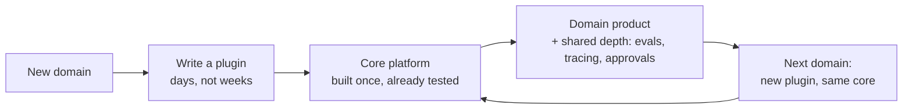

What this buys:

| Before | After |
|---|---|
| New repo per domain | One repo, one plugin per domain |
| Plumbing rebuilt every time | Plumbing improved once, every plugin benefits |
| Time spent on infrastructure | Time spent on the domain logic inside `tools.py` and `pipelines/` |
| Shallow demos | Every product has citations, evals, tracing and approval gates |

**What it does not buy:** domain expertise. A churn or robotics plugin still needs real ML depth inside its tools. The framework guarantees that time goes into the domain, not the plumbing.

## 3. The three layers

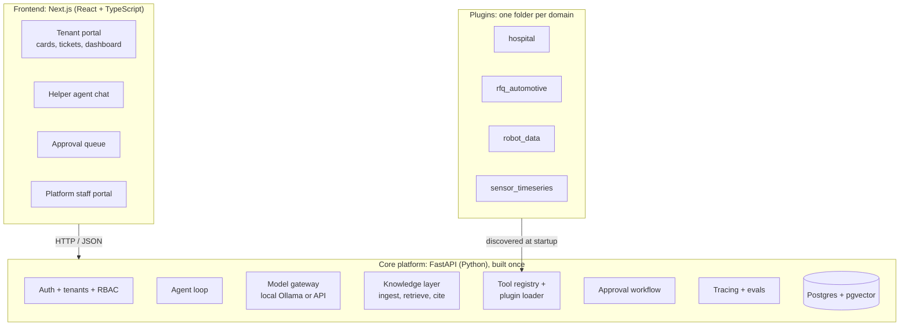

| Layer | Responsibility | Must NOT do |
|---|---|---|
| **Frontend** | Display data, collect input, render cards that plugins declare | Business rules, tenant isolation, ID generation, metric calculation, storing state |
| **Core** | Everything shared by every domain: identity, data, agents, models, retrieval, approvals, observability | Contain any domain word (`emergency`, `RFQ`, `robot`, `churn`) |
| **Plugin** | Domain knowledge: prompt, tools, pipelines, rules, seed data, evals, card definitions | Import another plugin, modify the core, bypass approval gates |

### Core components

| Component | What it does | Why it matters |
|---|---|---|
| **Agent loop** | Plan → call a tool → observe → repeat, max N steps | Hand-written (~150 lines) so every line can be explained |
| **Model gateway** | `chat()`, `structured()`, `embed()`, `vision()`, `rerank()`, local or API backend | No data leakage with local models; swap models without touching agents |
| **Knowledge layer** | PDF → text + tables + page images → chunks → embeddings; retrieval returns page + region | Citations a human can verify in seconds |
| **Tool registry** | Holds core tools (`search_documents`) plus the active plugin's tools; validates arguments with Pydantic | Wrong tool arguments are rejected, not executed |
| **Approval workflow** | Actions marked `requires_approval` stop in `waiting_approval` until a human decides | The agent proposes, a human approves |
| **Memory / state** | Conversation history and run checkpoints, so a run can pause for approval and resume | Approvals and crashes don't lose work |
| **Guardrails** | Input and output checks: schema validation, "citation required", abstain on low confidence, PII redaction | Unsafe or unsupported answers are blocked in code |
| **Tracing** | Every step logged: tool, duration, tokens, cost | Fills the dashboard with real numbers; finds bottlenecks |
| **Evals** | Runs each plugin's `evals.jsonl`, reports accuracy and citation correctness | Proves how good the system is instead of claiming it |
| **Job queue** *(planned)* | Long-running work (training, batch extraction) runs in the background | Needed by ML and robotics plugins |
| **Artifact registry** *(planned)* | Stores models, datasets and metrics with versions | Needed for retraining and comparison |

### Ports and adapters: every core component is swappable

Every core component is built as a **port** (a small interface the core owns) with one or more **adapters** (implementations) behind it. A plugin chooses its adapters in `plugin.yaml`; a tenant can override some choices (for example "local models only"). This is the *ports-and-adapters* (hexagonal) architecture: **the core depends on interfaces, not on frameworks.**

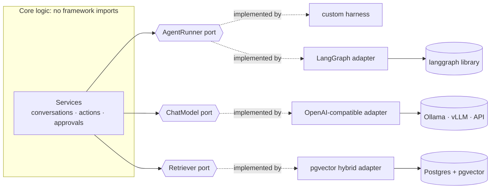

**How it stays honest:**

1. **Interfaces only at the edges.** A port defines what goes in (messages, tools, limits) and what comes out (result, trace events, an approval signal). How a framework works inside is the adapter's business; the core never forces three frameworks into one shape.
2. **Shared core types are the only currency:** `Message`, `ToolSpec`, `ToolCall`, `TraceEvent`, `AgentResult`, `Element`, `Chunk`, `Citation`. Every adapter speaks them.
3. **Tools are defined once.** A tool is a Pydantic input/output model plus `requires_approval`. Each agent adapter *exports* the registry's tools into its framework's format.
4. **Approvals and tracing are part of the contract.** Every agent adapter must map its framework's pause/resume onto the core's `waiting_approval` state and emit the same trace events. An adapter that can't is not accepted.
5. **Contract tests.** Each port has one shared test suite that every adapter must pass (tool called, approval pauses the run, step limit respected, trace events emitted).
6. **Frameworks are optional installs.** `import langgraph` or `import pydantic_ai` appears only inside its adapter file; frameworks are installed as extras (`pip install -e ".[langgraph]"`). The core fails at startup with a clear message if a plugin asks for an adapter that isn't installed.
7. **Settings precedence:** platform default → plugin (`plugin.yaml`) → tenant override.
8. **Build on demand.** Each port starts with one default adapter. A second adapter is added when a plugin needs it; two working adapters prove the interface.
9. **Compare adapters on the same evals.** The same plugin eval set runs against every agent adapter, producing a comparison table (accuracy, latency, tokens, steps).

Code shape:

```
api/core/<component>/
  base.py          # the port: a typing.Protocol + its input/output types
  adapters/
    <option>.py    # one file per adapter
  registry.py      # name -> adapter, validated at startup
api/tests/contracts/test_<component>_contract.py   # every adapter must pass
```

### What we build: the runtime core

Solid blue = built **before 30 Nov 2026**. Dashed grey = planned, added when a plugin needs it. Hexagons are ports.

```mermaid
flowchart TB
    classDef now fill:#dbeafe,stroke:#1d4ed8,color:#0f172a
    classDef later fill:#f8fafc,stroke:#94a3b8,color:#64748b,stroke-dasharray: 4 3
    classDef port fill:#0f172a,stroke:#0f172a,color:#ffffff

    CFG["plugin.yaml + tenant overrides"] -->|selects adapters| REG["Adapter registry<br/>validated at startup"]

    subgraph AGENT["Agent runtime"]
        PA{{"AgentRunner"}}:::port
        A1["Custom harness loop"]:::now
        A2["Pipeline runner (no LLM)"]:::now
        A3["LangGraph"]:::now
        A4["Pydantic AI"]:::later
    end

    subgraph MODEL["Model gateway"]
        PM{{"ChatModel · Embedder · Vision · Reranker"}}:::port
        M1["OpenAI-compatible client<br/>(Ollama, vLLM, LM Studio, OpenAI)"]:::now
        M2["Anthropic"]:::later
        M3["Azure OpenAI (EU)"]:::later
        M4["LiteLLM"]:::later
    end

    subgraph TOOLS["Tool registry"]
        PT{{"ToolSpec"}}:::port
        T1["Python tools from plugins"]:::now
        T2["Export to custom + LangGraph"]:::now
        T3["MCP client (use external tools)"]:::later
        T4["MCP server (expose Kontor tools)"]:::later
        T5["OpenAPI / HTTP tools"]:::later
    end

    subgraph STATE["Memory / state"]
        PS{{"ConversationStore · Checkpointer"}}:::port
        S1["Postgres"]:::now
        S2["LangGraph checkpointer<br/>(mapped to core state)"]:::now
        S3["Long-term user memory"]:::later
    end

    subgraph POLICY["Policy + approvals"]
        PP{{"PolicyEngine"}}:::port
        PO1["Python rules (rules.py)"]:::now
        PO2["YAML rules"]:::later
        PO3["Cedar / OPA"]:::later
    end

    subgraph GUARD["Guardrails"]
        PG{{"InputGuard · OutputGuard"}}:::port
        G1["Schema validation · citation required · abstain"]:::now
        G2["PII redaction"]:::later
        G3["Prompt-injection checks"]:::later
    end

    subgraph TRACE["Tracing"]
        PTR{{"TraceSink"}}:::port
        TR1["Postgres trace table"]:::now
        TR2["OpenTelemetry"]:::later
        TR3["Langfuse / LangSmith"]:::later
    end

    subgraph EVALS["Evals"]
        PE{{"EvalRunner"}}:::port
        E1["evals.jsonl runner (pytest)"]:::now
        E2["Retrieval metrics: recall@k, MRR"]:::now
        E3["LLM-as-judge"]:::later
        E4["promptfoo / DeepEval"]:::later
    end

    subgraph IO["Channels · auth · storage · jobs"]
        PC{{"Channel · Auth · ObjectStore · JobQueue · ArtifactStore"}}:::port
        C1["Web chat"]:::now
        C2["Session auth"]:::now
        C3["Local disk storage"]:::now
        C4["In-process background jobs"]:::now
        C5["Outlook · WhatsApp · voice"]:::later
        C6["OIDC / SSO (Entra ID)"]:::later
        C7["S3 (LocalStack, then AWS)"]:::later
        C8["Postgres queue · Celery · SQS"]:::later
        C9["MLflow artifact registry"]:::later
    end

    REG --> PA & PM & PT & PS & PP & PG & PTR & PE & PC
    PA --- A1 & A2 & A3 & A4
    PM --- M1 & M2 & M3 & M4
    PT --- T1 & T2 & T3 & T4 & T5
    PS --- S1 & S2 & S3
    PP --- PO1 & PO2 & PO3
    PG --- G1 & G2 & G3
    PTR --- TR1 & TR2 & TR3
    PE --- E1 & E2 & E3 & E4
    PC --- C1 & C2 & C3 & C4 & C5 & C6 & C7 & C8 & C9
```

Ollama, vLLM and LM Studio all speak the OpenAI API format, so **one** model adapter covers local models and OpenAI-style APIs; the model is chosen by URL and name in config.

### What we build: the knowledge pipeline

The knowledge layer is a chain of **stages**, each a port with its own adapters. A document is split into **elements** (text, table, image, chart, drawing), and each element type is routed to its own handler. A plugin switches on only the stages and handlers it needs.


How two plugins choose different depths from the same pipeline:

```yaml
# plugins/hospital/plugin.yaml (excerpt)
agent:
  runtime: custom            # custom | langgraph | pydantic_ai | pipeline
  max_steps: 8
models:
  chat: local/qwen-tool-calling
  embeddings: local/multilingual
knowledge:
  parsers: [text, pdf_text]
  elements: { tables: off, images: off, charts: off }
  chunking: structure
  retrieval: hybrid
  rerank: off
  citations: page
```

```yaml
# plugins/rfq_automotive/plugin.yaml (excerpt)
agent:
  runtime: langgraph
knowledge:
  parsers: [pdf_layout, ocr]
  elements: { tables: docling, images: vlm_caption, charts: vlm_to_table, drawings: region_review }
  retrieval: hybrid
  rerank: cross_encoder
  citations: region
```

## 4. The plugin contract

Every plugin is a folder with the same shape. The core never imports a plugin by name; it discovers folders.

```
plugins/
  <domain>/
    plugin.yaml      # name, model, enabled core tools, ACTIONS (cards), flags, approval rules
    prompt.md        # system prompt for the helper agent
    tools.py         # domain tools: plain Python functions with typed inputs/outputs
    rules.py         # deterministic rules (e.g. emergency keywords): code decides, never the LLM alone
    pipelines/       # optional: fixed workflows (extraction, training, evaluation)
    seed_data/       # sample documents / datasets for the demo
    evals.jsonl      # test cases with expected answers
    README.md        # what this plugin proves, with its eval results
```

### `plugin.yaml` declares the UI too

The frontend has **one generic card renderer**. It shows whatever actions the active plugin declares, so a new domain needs no new pages.

```yaml
name: hospital
display_name: Patient service desk
agent: { runtime: custom, max_steps: 8 }   # which AgentRunner adapter
model: local/qwen-tool-calling       # resolved by the model gateway
knowledge: { parsers: [text, pdf_text], retrieval: hybrid, citations: page }
core_tools: [search_documents]
flags: [emergency]                   # plugin-specific conversation flags
actions:
  - id: protocol_search
    title: Search protocols
    kind: chat                       # opens the helper agent scoped to this task
  - id: bed_status
    title: Bed status
    pipeline: pipelines.bed_status   # deterministic, no LLM decision involved
  - id: medical_letter_request
    title: Medical letter requests
    pipeline: pipelines.letter_request
    requires_approval: true          # stops in waiting_approval
helper_agent: true
```

### Design principles

1. **The LLM handles language and routing. Code handles correctness.** `check_bed_availability()` is a database query; the agent only decides to call it and phrases the answer.
2. **Fixed order → pipeline, not agent.** If steps always run in the same order, run them as code. The agent sits on top to explain, compare and answer questions.
3. **Numbers come only from tools.** The LLM never computes or retypes figures; tables and charts render directly from tool output.
4. **Abstain instead of guessing.** "Not found" or "low confidence, please verify" beats a confident wrong answer.
5. **Every plugin ships evals.** No eval score, no claim.

## 5. One request, end to end

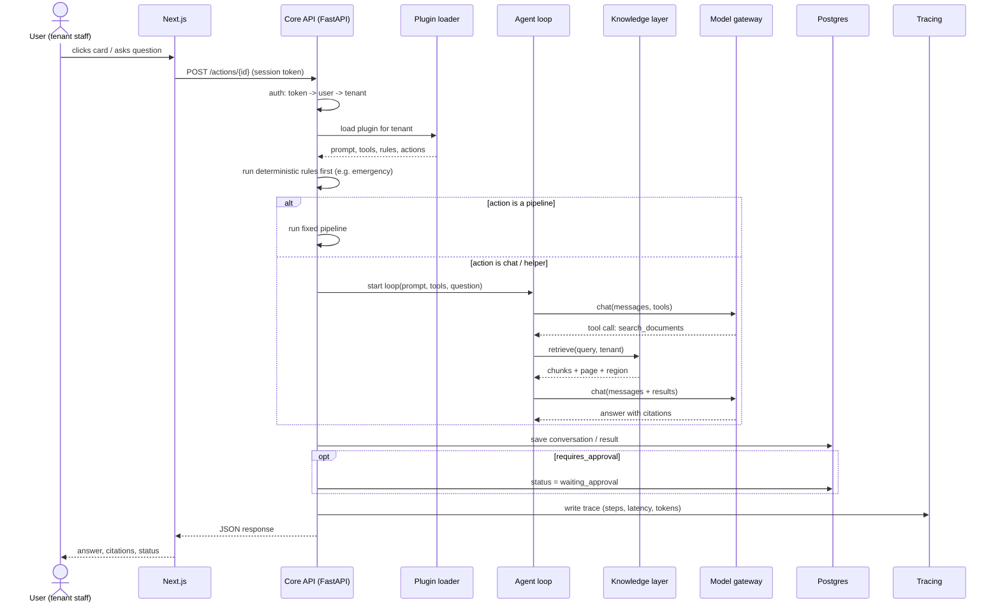

## 6. Four domains, one platform

For each domain: what it needs, which plugins serve it, the flow, and what is reused vs. new.

### 6.1 Agentic operations: multi-channel service desk

**What the domain needs:** a multi-tenant platform where agents handle inbound communication (phone, WhatsApp, email, web) for different industries, with escalation, approvals and an operator view.

**Plugins:** `hospital`, `sales`, `rfq_intake`

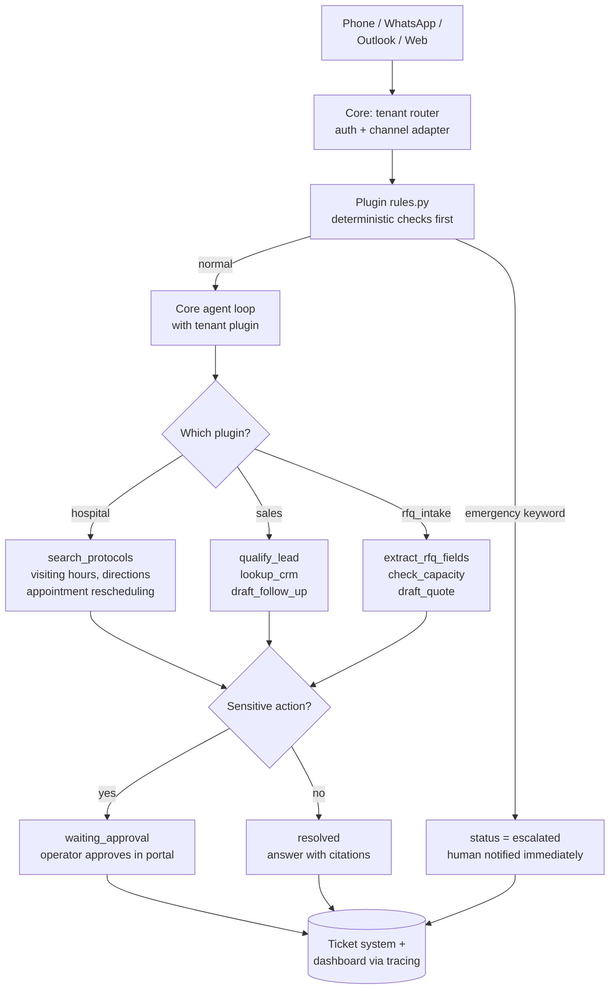

| Reused from core | New in plugins |
|---|---|
| Channels, tenants, agent loop, approvals, ticket table, dashboard, security, support queue | Prompts, domain tools, emergency rules (hospital), CRM tool (sales), RFQ schema (rfq_intake) |

**What it proves:** multi-tenancy, safe escalation, human-in-the-loop, operator UX.

### 6.2 Document intelligence for manufacturing RFQs

**What the domain needs:** reliable extraction from complex technical documents (tables, drawings, specs) and answers a buyer or engineer can trust.

**Plugins:** `rfq_automotive` (e.g. a parts supplier receiving an RFQ from a car maker), `rfq_rail` (a train-component supplier)

The core is the same; the plugins differ in **schema, rules and standards**:

| | `rfq_automotive` | `rfq_rail` |
|---|---|---|
| Extracted fields | Part numbers, annual volumes, SOP date, material, tolerances, PPAP level | Part numbers, quantities, delivery lots, material, fire-safety class |
| Standards checked | IATF 16949, VDA requirements | EN 45545 (fire protection), EN 15085 (welding) |
| Rules | Volumes x price ≤ budget, SOP date in the future | Fire-safety class present for interior parts |

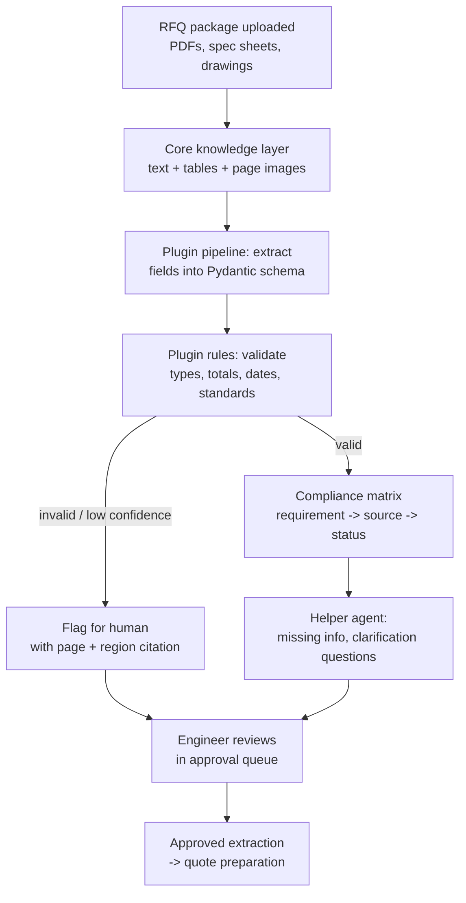

**Honest limit:** title blocks, BOM tables and notes on drawings extract well; dimensions and GD&T symbols do not extract reliably and are always routed to human review.

| Reused from core | New in plugins |
|---|---|
| Ingestion, page images, retrieval, citations, approval queue, evals runner | Extraction schemas, standards rules, compliance matrix pipeline, RFQ eval sets |

**What it proves:** measured extraction accuracy (by element type: text, tables, charts), citations to page regions, abstention.

### 6.3 Robotics: data curation and downstream learning

**What the domain needs:** turning raw robot data into curated training datasets, generating synthetic data, and connecting data to downstream model training.

**Plugins:** `robot_data_curation`, `downstream_learning`, `data_visualization`

The agent **orchestrates and verifies**. The heavy work (simulation, training, VLM labeling) lives in scripts called by `tools.py` and runs on the job queue.

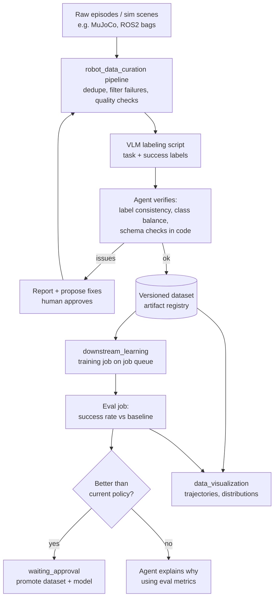

| Reused from core | New in plugins |
|---|---|
| Agent loop, approvals, tracing, evals, UI cards, job queue, artifact registry | Curation filters, VLM labeling script, training/eval scripts, visualization renderers |

**What it proves:** agentic loops applied to data generation and curation, with verification done in code. The agent is a supervisor, not the domain engine.

### 6.4 Time-series ML for sensor data

**What the domain needs:** solid ML on sensor data (anomaly detection, forecasting, drift) and a way for non-technical teams to use the results.

**Plugin:** `sensor_timeseries` (built on an M.Sc. thesis pipeline for monitoring manufacturing processes)

Cards: **Analyze data**, **Detect anomalies**, **Check drift**, **Retrain**, **Model history**. The agent classifies intent and explains; the pipelines do the work.

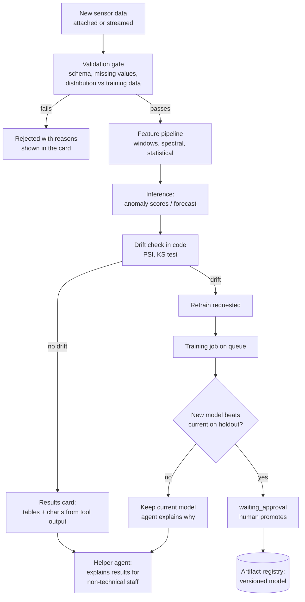

| Reused from core | New in plugins |
|---|---|
| Cards UI, approvals, job queue, artifact registry, tracing, helper agent | Feature engineering, models, drift tests, holdout evaluation, the ML itself |

**What it proves:** real ML depth first; then the last-mile layer that makes model output usable by people who don't open MLflow.

### Summary: one core, four domains

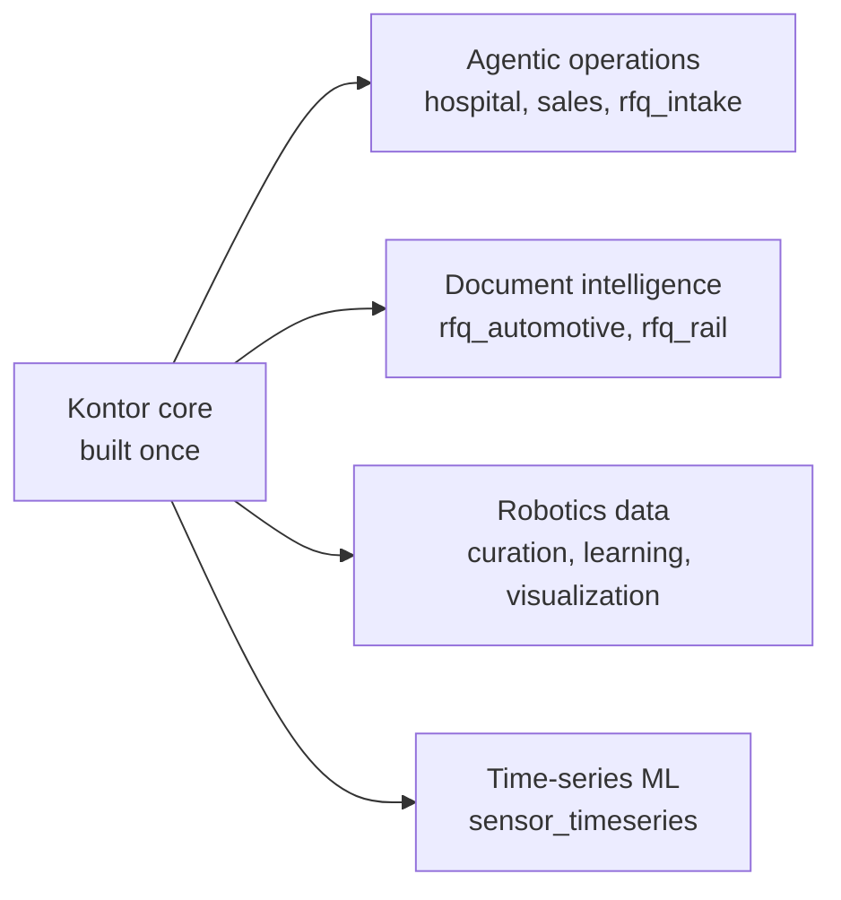

| Domain | Core features that matter most | Plugin depth that matters most |
|---|---|---|
| Agentic operations | Multi-tenancy, channels, approvals, operator UI | Escalation rules, prompt/tool reliability |
| Document intelligence | Ingestion, citations, evals | Extraction accuracy per element type, abstention |
| Robotics data | Job queue, artifact registry, verification | Curation quality, labeling, training evaluation |
| Time-series ML | Job queue, registry, approval gate | Features, validation strategy, drift, model choice |

## 7. Core capabilities the plugins require

| Capability | Needed by | Status |
|---|---|---|
| Auth, tenants, RBAC | All | ✅ OIDC sign-in via Keycloak (two realms, MFA for staff), JWT verification in the API, tenant + role from Kontor's database, admin-only endpoints |
| Agent loop + tool registry + plugin loader | All | Planned |
| Model gateway (local + API) | All | Planned |
| Knowledge layer with page-region citations | Operations, documents | Planned |
| Approval workflow | All | Data model exists (`waiting_approval`), logic planned |
| Tracing → dashboard metrics | All | Dashboard served by the API (ticket metrics in SQL); usage numbers seeded until tracing |
| Eval runner | All | Planned |
| Structured extraction + validation | Documents, operations `rfq_intake` | Planned |
| Channel adapters (voice, WhatsApp, Outlook) | Operations | Web channel first; others later |
| Job queue | Robotics, time-series | After Dec 2026 |
| Artifact / model registry | Robotics, time-series | After Dec 2026 |

## 8. Current repo: where the frontend is doing the core's job

Milestone 1 built a **Next.js tenant portal on mock data** in which several **core responsibilities lived in the frontend**. This table tracks moving each one to where it belongs. **Milestone 2 moved rows 1–9 into the FastAPI core** (✅ done, 🟡 partly done). Remaining stand-ins are marked in the code with `STAND-IN → core` (or `→ plugin`) comments naming their row.

| # | Status |
|---|---|
| 1 | ✅ M2 |
| 2 | ✅ M3: real sign-in (OpenID Connect + Keycloak); the API resolves user, tenant and role from the verified token |
| 3 | ✅ M2 |
| 4 | 🟡 M2: numbers moved to the `usage_snapshots` table (seeded); measured by tracing later |
| 5 | ✅ M2 |
| 6 | ✅ M2 |
| 7 | ✅ M2 |
| 8 | ✅ M2 |
| 9 | ✅ M2 |
| 10 | 🟡 M2: core `Conversation` has generic `flags` + `attributes`; the hospital plugin declaring `emergency` follows with plugins |
| 11 | Open: home cards still hard-coded |
| 12 | ✅ Done: `lib/platform.ts` |
| 13 | Open: emergency outcome is still seed data; `plugins/hospital/rules.py` will decide it |

The original analysis:

| # | Where | What the frontend is doing | Why it belongs in the core | Target |
|---|---|---|---|---|
| 1 | `lib/api.ts` (all getters) | **Tenant isolation** by filtering `tenantId` in TypeScript | Filtering in the UI is not security. A direct API call would see everything. | Core derives tenant from the session; every query filtered server-side (consider Postgres row-level security) |
| 2 | `lib/config.ts` | **Identity**: `CURRENT_TENANT`, `CURRENT_USER` hardcoded | The user and tenant must come from authentication, never from frontend config | Core auth (session/JWT); frontend reads `/me` |
| 3 | `lib/api.ts` → `getDashboardMetrics` | **Metric calculation** (counts by status/channel, open, emergencies) | Business logic duplicated in the UI drifts from the truth; other clients can't reuse it | Core endpoint `/metrics`, computed in SQL / from traces |
| 4 | `lib/mock-metrics.ts` | **API health numbers** (p95 latency, error rate) invented | Must be measured | Core tracing |
| 5 | `lib/api.ts` → `createSupportIssue` | **ID generation** (`max + 1` → `SUP-1046`) and **state mutation** (`mockSupportIssues.push`) | `max + 1` breaks with two concurrent requests; in-memory state is lost on restart | Database sequence / UUID in Postgres |
| 6 | `app/(tenant)/support/actions.ts` | **Authoritative validation** and the **ticket ownership check** | Validation is correct and well written, but the backend must be the source of truth | Pydantic models in core; keep the frontend checks for fast UX feedback only |
| 7 | `lib/api.ts` → `getAllSupportIssues` | **Authorization** is missing ("STAND-IN: no authorisation check yet") | Anyone reaching this function sees every tenant's issues | Core RBAC: `platform_staff` role required |
| 8 | `lib/api.ts` → `severityRank` sort | **Triage ordering** (severity, then oldest) | A business rule; other clients (email digests, alerts) need the same order | Core query `ORDER BY` |
| 9 | `lib/types.ts` | **The API contract is defined in the frontend** | Two copies of every type (TS + Python) will drift | Pydantic models are the source of truth; generate TS types from FastAPI's OpenAPI schema (`openapi-typescript`) |
| 10 | `lib/types.ts` → `Conversation`, `Channel` | **Hospital domain in core types**: `emergency`, `callerName`, hospital-style channels | A churn or robotics plugin would inherit a field called `emergency` | Core `Conversation` with generic `flags: string[]` + `data: object`; hospital plugin declares `emergency` |
| 11 | `app/(tenant)/page.tsx` | **Home cards hardcoded** (tickets, dashboard, security, support) | Domain actions can't be added without new frontend code | Platform cards stay; domain cards rendered from `plugin.yaml` actions |
| 12 | ~~10+ places~~ | ~~**Company branding hardcoded**~~ ✅ **Done:** `PLATFORM_NAME` and `PLATFORM_TEAM` in `lib/platform.ts` | Ties the platform to one company | — |
| 13 | `lib/mock-data.ts` (`c-1001` chest pain → escalated) | **Emergency outcome** is mock data, nothing decides it | When real, this must be a deterministic rule, not an LLM judgement | `plugins/hospital/rules.py`, always escalates to a human |

**What's already right and should be kept:** the single data seam (`api.ts`), the `c-2001` cross-tenant leak test (turn it into an automated backend test), server-side re-validation in server actions, the tenant always taken from the server, the `waiting_approval` status, and dashboard fields that match what tracing will produce.

## 9. Migration: from today's repo to the target

### Target structure

```
kontor/
  web/                       # Next.js: thin client, no business logic
    src/lib/api.ts           # fetch() calls to the core API only
    src/lib/api-types.ts     # GENERATED from OpenAPI, never hand-edited
    src/components/action-card.tsx   # generic renderer for plugin actions
  api/                       # FastAPI core
    main.py
    Dockerfile
    core/                    # every component: base.py (port) + adapters/ + registry.py
      types.py               # shared types: Message, ToolSpec, TraceEvent, Chunk, Citation ...
      auth/                  # sessions, tenants, RBAC
      agent/                 # adapters: custom.py, pipeline.py, langgraph.py
      models/                # adapters: openai_compatible.py
      tools/                 # registry + exporters per agent adapter
      knowledge/             # sources/, parsers/, elements/, chunking/, embeddings/, retrieval/, citations/
      state/  policy/  guardrails/  tracing/  evals/  storage/  jobs/
      plugins/loader.py
      metrics.py
    plugins/
      hospital/
      rfq_automotive/
    tests/
      contracts/             # one suite per port, every adapter must pass
      test_tenant_isolation.py   # the c-2001 leak test, server-side
  deploy/                    # see section 11
  infra/
  loadtest/
  .github/workflows/ci.yml
  Jenkinsfile
```

### Migration flow

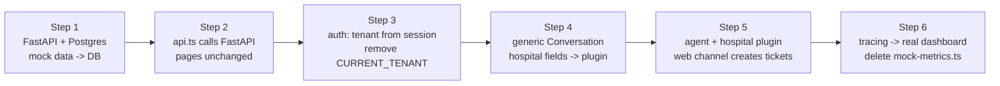

### Plan until 30 Nov 2026

| Dates | Goal | Done when |
|---|---|---|
| 6–15 Nov | Core backend + knowledge layer | Ports and shared types defined; Dockerfiles + Compose + GitHub Actions CI; pages load from FastAPI; a question about a hospital PDF returns an answer with page citations; hard-PDF accuracy test measured |
| 16–22 Nov | Agent loop + plugin loader + hospital plugin | Custom harness adapter passes the agent contract tests; a web chat message creates a ticket in the existing ticket table; emergency rule escalates; approval buttons work |
| 23–29 Nov | Prove the platform | Dashboard shows traced numbers; hospital eval score in README; **LangGraph adapter** passes the contract tests and is compared with the custom loop on the same evals; second plugin built in ≤ 2 days; demo video |
| 30 Nov | Buffer | Everything pushed |

**Frozen until then:** new frontend pages, security and support features (stay mock, labelled as such), voice/WhatsApp/Outlook channels, every dashed ("later") adapter in section 3, Kubernetes/ArgoCD/Jenkins/Terraform/Kubeflow (section 11), Rust components (only after load tests show a need).

## 10. Rules for contributors and AI coding assistants

Read this section before changing code.

1. **Ask "core or plugin?" before writing anything.** If the code mentions a domain concept (patient, RFQ, robot, churn, sensor), it belongs in `plugins/<domain>/`. If every domain needs it, it belongs in `api/core/`.
2. **The core never imports from `plugins/`.** Plugins are discovered by the loader. Plugins never import each other.
3. **The frontend contains no business logic.** No tenant filtering, ID generation, metric calculation, authorization or persistent state. Validation in the frontend is for UX only; Pydantic in the core is authoritative.
4. **The tenant comes from the session, on the server.** Never from a URL, form field or frontend config.
5. **Never hand-edit generated types.** Change the Pydantic model, regenerate TypeScript.
6. **LLMs route and explain; code decides.** Safety rules, validation, calculations and comparisons are deterministic Python. The LLM never produces numbers that a tool didn't return.
7. **Fixed sequences are pipelines, not agent decisions.**
8. **Anything irreversible or sensitive is `requires_approval: true`.**
9. **Every plugin ships `evals.jsonl`, and every core change runs the evals.**
10. **Keep CPU-heavy steps behind plain function signatures** (e.g. `chunk_document(text, max_tokens) -> list[Chunk]`) so they can be replaced with Rust later if profiling justifies it.
11. **Frameworks live only in adapters.** Never import LangGraph, Pydantic AI or a vendor SDK outside `core/<component>/adapters/`. A new adapter must pass its port's contract tests.
12. **Twelve-factor services.** Configuration only via environment variables, no state inside a process, logs to stdout, backing services reached by URL (see section 11).

### Commands (Windows, cmd in VS Code)

```cmd
:: core API + Postgres (migrations and demo data run automatically)
docker compose -f deploy/compose/docker-compose.yml up -d --build

:: frontend (first time: copy .env.example .env.local)
cd web
npm install
npm run dev

:: backend checks (inside api/, Postgres container running)
uv run pytest
uv run ruff check .
uv run mypy

:: after changing an API schema: regenerate the contract and the TS types
uv run python -m core.export_openapi openapi.json
cd ..\web
npm run gen:api

:: later, with the agent milestones: run plugin evals
python -m evals.run_evals --plugin hospital
```

Database on host port **5433** (5432 is often taken by a local PostgreSQL). API docs at http://localhost:8000/docs. Keycloak (sign-in) at http://localhost:8080 (admin console: `/admin`). Secrets and demo accounts: `deploy/compose/.env` (from `.env.example`). Every command, including debugging: `docs/commands.md`.

Git Bash alternative: same commands, with `#` instead of `::` for comments.

## 11. Delivery and operations: containers, CI/CD, cloud, scaling

Delivery tools are swappable too, but on a different axis from section 3: **the environment picks them, not the plugin.** The same containers run in three profiles:

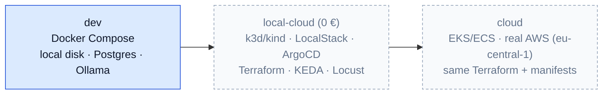

This works because the services follow the **twelve-factor** rules: configuration only through environment variables, no state inside a process, logs to stdout, and backing services (database, queue, storage) reached by URL. The cloud services the app *uses* are runtime ports in the core: `ObjectStore` is local disk in `dev` and S3 in `local-cloud` and `cloud`. LocalStack and real AWS use the same S3 adapter with a different endpoint URL.

| Layer | Default (built first) | Alternatives (later) |
|---|---|---|
| **Container images** | Multi-stage Dockerfiles for `api` and `web` | Podman; Buildpacks |
| **Local orchestration** | Docker Compose (Postgres + pgvector, Ollama, api, web) | k3d / kind |
| **Kubernetes manifests** | Kustomize `base/` + `overlays/{local,cloud}` | Helm chart |
| **Infrastructure as code** | Terraform + `tflocal` against LocalStack | OpenTofu; Pulumi; AWS CDK |
| **Cloud services (runtime ports)** | Local disk, Postgres queue, `.env` | S3, SQS, Secrets Manager (LocalStack → AWS); Azurite for Azure Storage |
| **CI** | GitHub Actions: lint, type-check, tests, contract tests, evals, build images | Jenkins (`Jenkinsfile`, same stages); GitLab CI |
| **Image registry** | GitHub Container Registry | Docker Hub; ECR (LocalStack) |
| **CD** | Compose redeploy (dev) | ArgoCD (GitOps); Argo Rollouts (canary, blue/green) |
| **Scaling** | Fixed replicas | HPA on CPU; KEDA on queue length |
| **Load testing** | — | Locust scenarios; k6 |
| **Ops monitoring** | Logs + core trace table | Prometheus + Grafana; OpenTelemetry Collector |
| **ML workloads** | Job queue + MLflow | Kubeflow Pipelines; Argo Workflows |
| **Supply-chain security** | Dependency audit in CI | Trivy image scan; gitleaks; SBOM |

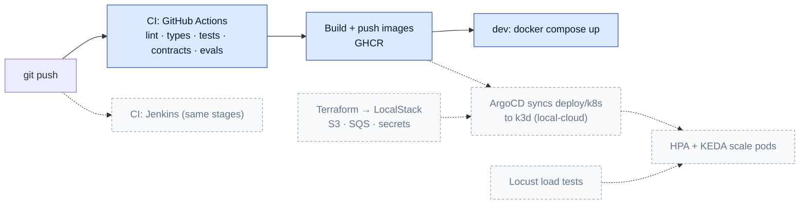

Repo layout for delivery:

```
api/Dockerfile   web/Dockerfile
deploy/
  compose/docker-compose.yml          # dev profile
  k8s/base/  k8s/overlays/{local,cloud}/
  argocd/kontor-app.yaml
infra/terraform/{modules/, envs/localstack/, envs/aws/}
.github/workflows/ci.yml
Jenkinsfile
loadtest/locustfile.py
```

Before 30 Nov only the solid-blue parts are built: Dockerfiles, Compose and the GitHub Actions workflow. Everything dashed follows after the platform is proven.
